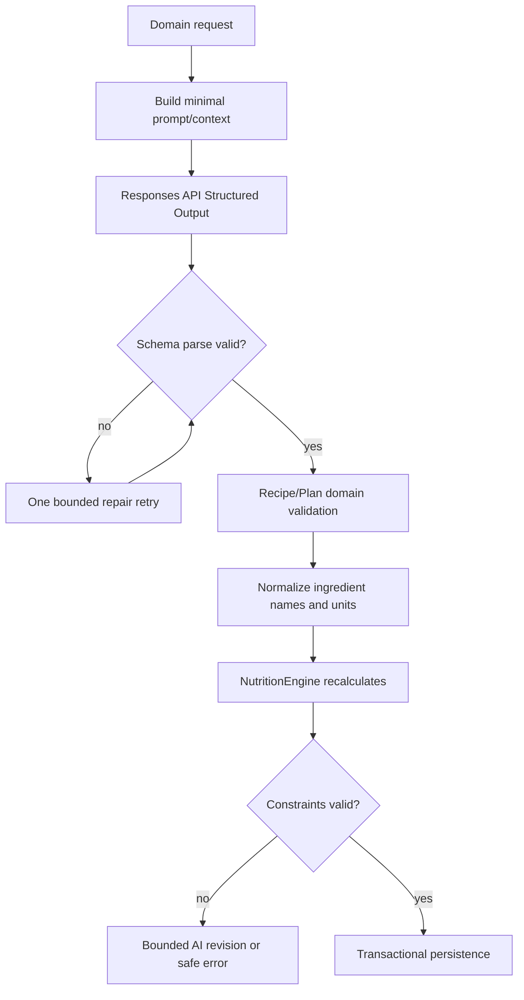

# AI-слой FoodAI

AI создаёт предложения и естественный язык. Он не является источником правды о calories, БЖУ, дефиците, аллергиях, price или доступе к Premium. Все решения, способные изменить product state, валидирует backend.

## Разделённые движки

| Компонент | Input | Output | Владелец final decision |
|---|---|---|---|
| `TextAIService` | task-specific system prompt + минимальный context | Structured Outputs для recipe/plan; plain/structured chat response | `RecipeEngine`, `MealPlanEngine`, `ChatEngine` |
| `NutritionEngine` | profile, active goal, canonical ingredients, servings | BMR/TDEE, calorie/macro targets, recalculated recipe/plan nutrition | backend only |
| `RecipeEngine` | AI recipe candidate + ingredient catalog | normalized valid `Recipe` или rejection | backend only |
| `MealPlanEngine` | validated recipes + day constraints | persisted plan/replacement или rejection | backend only |
| `ChatEngine` | message + minimal profile/plan/balance context | assistant message + optional proposed action | backend confirms mutation |
| `ImageGenerationService` | persisted recipe only | `RecipeImage` job/status/files | отдельный worker; не влияет на recipe existence |

Ни `TextAIService`, ни `ImageGenerationService` не вызываются Android. Единственный SDK/provider client расположен в `backend/app/integrations/openai/`; остальные сервисы зависят от typed interface, а не от OpenAI SDK. Image-specific правила — [image-generation.md](image-generation.md).

## Text generation contract

Text вызывается через OpenAI **Responses API** с Structured Outputs и versioned JSON Schema. Модель выбирается только через `OPENAI_TEXT_MODEL`; application code не содержит model name. Для каждой операции schema фиксируется рядом с domain model:

| Operation | Строгий result schema | AI не вправе определять |
|---|---|---|
| `generate_recipe_candidates` | name, servings, cooking_method, cook time, ingredients with quantity/unit, steps, optional rationale | calories/macros/cost as final values, unsafe ingredients |
| `generate_meal_plan_proposal` | day/meal slots, references to candidate recipes, planning rationale | calorie target, entitlement, final plan validity |
| `replace_meal_item` | one or more candidate recipes + reason | обход allergies/exclusions, final macro balance |
| `chat_answer` | answer text, `suggested_actions[]`, warnings | diagnosis, treatment, guaranteed weight result |

System prompt требует русский user-facing text, конкретные grams/servings/steps и отсутствие выдуманных врачебных утверждений. Ingredient names не считаются canonical, пока `RecipeEngine` их не сопоставит. Text output не сохраняется как recipe до Pydantic schema validation.

## Pipeline validation и retry



Правила:

1. timeout, invalid JSON, schema error и unknown ingredient не создают partial recipe/plan;
2. один repair retry использует validation feedback без profile secrets; maximum attempts задаётся `AI_TEXT_MAX_ATTEMPTS`;
3. если validation не проходит после repair, meal-plan generate/replace **не отдаёт 422 пользователю**: делается каталожный fallback с warning; прямой `POST /recipes` по-прежнему может вернуть `422 recipe_validation_error`;
4. при `ai_quota_exhausted` / provider unavailable meal-plan generate/replace использует **каталожный fallback** (без live AI), добавляя warning в ответ — Android получает план, а не вечный 503;
5. AI ingredient names сопоставляются со справочником через exact key, aliases и soft token match; в prompt передаётся `allowed_ingredients`;
6. final nutrition/cost берутся исключительно из пересчёта backend и snapshot в `meal_plan_items`;
7. AI output/response model/version, latency, token counts, operation и estimated cost записываются в `ai_text_usage`; raw prompts с PII не пишутся в logs.

## Nutrition Engine: authoritative math

`NutritionEngine` не зависит от provider и имеет детерминированные unit tests. Он рассчитывает:

- BMR: Mifflin–St Jeor на основании `sex`, age, height и current weight;
- TDEE: `BMR × activity_factor`, где значения factor versioned/configured;
- calorie target: TDEE с выбранным deficit/surplus и desired weekly rate, ограниченный safety floor;
- macro targets: protein/fat/carbohydrate в граммах согласно product policy и calorie target;
- recipe nutrition: сумма canonical `ingredients.*_per_100g × recipe_ingredients.quantity_g / 100`;
- plan checks: daily calories/macros, meals/day, allergens, exclusions, time, budget, servings/household и pantry.

Начальные configurable guardrails: `NUTRITION_MIN_DAILY_CALORIES_FEMALE=1200`, `NUTRITION_MIN_DAILY_CALORIES_MALE=1500`, `NUTRITION_MAX_WEEKLY_WEIGHT_CHANGE_KG`, `NUTRITION_ACTIVITY_FACTORS_JSON`. Их изменения versionируются и требуют product/clinical review. Для нераспознанного sex backend использует более консервативный high floor и возвращает объяснение. Это не диагностика: UI/API всегда несут disclaimer «Расчёты приблизительны и не заменяют врача или диетолога».

## Contextual chat

Перед запросом `ChatEngine` формирует минимальный user-scoped context:

```json
{
  "locale": "ru-RU",
  "active_goal": {"type": "lose_weight", "calorie_target_kcal": 1807},
  "today_balance": {"calories_remaining_kcal": 560, "protein_remaining_g": 31},
  "current_plan_summary": [{"meal_type": "dinner", "recipe_id": "uuid", "name": "..." }],
  "restrictions": ["арахис", "свинина"],
  "preferences": ["гречка"],
  "recent_messages": ["bounded, most recent messages only"]
}
```

Не включать password, tokens, API keys, полный неизбирательный profile history, raw weight history или лишние conversations. Сообщение может предложить `replace_meal_item`, `open_shopping_list` или `explain_balance`, но не исполняет команду. Android показывает proposal и вызывает отдельный authenticated API endpoint после user intent.

Запросы на медицинский диагноз, лечение, опасное ограничение питания либо гарантию результата получают безопасный отказ/redirect к врачу. Chat не утверждает, что пользователь непременно похудеет.

## Usage, cache и лимиты

| Механизм | Policy |
|---|---|
| `usage_limits` | Atomic check/increment до paid provider call; quotas раздельны для plan, replacement, chat и image |
| `EntitlementsService` | `get_tier()`, `require_premium()`, `consume(feature)`; Free defaults: 10 plan/day, 15 replace/day, 40 chat/day, 15 AI recommendations/day; `image_regenerate` — Premium only |
| `PaymentProvider` | Interface only (`NullPaymentProvider`); Google Play / RU / international adapters later |
| `ai_text_usage` | operation/model/tokens/latency/status/estimated cost; без secrets и unnecessary raw context |
| Redis cache | key содержит operation, schema version, normalized non-sensitive request fingerprint и model config version; TTL environment-configurable |
| Persisted plans | `GET today/week` читает PostgreSQL, не вызывает AI |
| Idempotency | `Idempotency-Key` предотвращает двойную генерацию от retry Android |
| Admin aggregates (Phase 17) | `GET /admin/ai/summary|daily|by-operation` over usage tables; `users.role=admin` + `ADMIN_EMAILS` bootstrap; no prompts/secrets in responses |
| Rate limiting | per-user + per-IP на auth/analytics; per-user/tier на costly AI calls; `429 usage_limit_exceeded` с Retry-After |
| Dedup | canonical `recipe_fingerprint` повторно использует existing recipe/image при идентичном блюде |

Cache hit не расходует provider quota/cost, но audit должен отличать `cached` от real call. Entitlement проверяется server-side через `require_premium()`; Android лишь отображает результат.

## Конфигурация и secrets

Минимальные environment variables:

```dotenv
OPENAI_API_KEY=
OPENAI_TEXT_MODEL=
OPENAI_TEXT_TIMEOUT_SECONDS=30
OPENAI_TEXT_MAX_ATTEMPTS=2
OPENAI_RESPONSE_SCHEMA_VERSION=2
AI_CACHE_TTL_SECONDS=86400
AI_RATE_LIMIT_FREE_PER_DAY=
AI_RATE_LIMIT_PREMIUM_PER_DAY=
NUTRITION_MIN_DAILY_CALORIES_FEMALE=1200
NUTRITION_MIN_DAILY_CALORIES_MALE=1500
```

`OPENAI_API_KEY` находится только в environment backend и worker, в `.env` локально и secret manager в production; `.env.example` содержит только пустые/non-secret defaults. Model swap — изменение environment/config deployment, не Android app release. Provider errors классифицируются и redacted; API keys, full prompts и персональные данные не попадают в structured logs.

## Тестируемость

`TextGenerationProvider` для product text — `DeepSeekChatProvider`, а при его недоступности (auth/quota/timeout) — `OpenAIResponsesProvider` через `FallbackTextProvider`; в test или без ключей — `MockTextProvider`. После `ai_auth_error` провайдер отключается до перезапуска процесса. Food photo → `OpenAIVisionProvider`. Image generation → `OpenAIImageProvider`. Матрица: [ai-provider-routing.md](ai-provider-routing.md).

pytest не выполняет сетевых вызовов к OpenAI/DeepSeek. Обязательные tests: provider routing, JSON schema failure/retry, unknown ingredients, nutrition override, allergy/exclusion, plan mismatch, ownership, cache/idempotency, quota, food photo mock vision, safe chat. Image contract — `MockImageProvider`.

## Phase 5 implementation notes

Реализовано в коде:

- `backend/app/integrations/openai/` — OpenAI SDK boundary (`client.py`, `text.py`, `images.py`, `vision.py`);
- `backend/app/integrations/deepseek/` — DeepSeek Chat Completions + JSON mode;
- `backend/app/ai/` — `TextAIService`, schemas, prompts, cache, `ai_text_usage`, `MockTextProvider`;
- migration `0004_ai_text_usage`;
- Redis cache key = operation + model + schema version + normalized payload fingerprint;
- repair retry bounded by `OPENAI_TEXT_MAX_ATTEMPTS` (default 2);
- **Phase 21 runtime:** DeepSeek = exclusive product text; OpenAI = vision + image generation only.

Meal-plan HTTP endpoints и Chat API вызывают этот слой.

Связанные спецификации: [architecture.md](architecture.md), [database.md](database.md), [api.md](api.md), [development.md](development.md), [ai-provider-routing.md](ai-provider-routing.md).

## Phase 20 — Adaptive AI

Дополнение к Text AI: предложения еды, адаптация дня, замены ингредиентов и варианты рецептов. Принцип тот же — AI только предлагает кандидатов; `RecipeEngine` / Nutrition / MealPlan владеют финальными цифрами и ограничениями. Невалидный AI output не персистится. Raw prompts не пишутся в logs/DB.

| Операция | Endpoint | Text op | Quota |
|---|---|---|---|
| Food suggestion | `POST /ai/recommendations` | `food_suggestion` | `ai_recommendation` (Free ~15/day) |
| Adapt day | `POST /ai/adapt-day` | `daily_adaptation` | `ai_recommendation` |
| Ingredient substitution | `POST /ai/ingredient-substitution` | `ingredient_substitution` | `ai_recommendation` |
| Recipe variant | `POST /ai/recipe-variant` | `recipe_variant` | `ai_recommendation` |
| Apply / execute | `POST /ai/recommendations/{id}/apply`, `POST /ai/actions/execute` | — | replace quota только при `replace_meal_item` |

`AIContextBuilder` собирает единый context (`context_version=v2`): goal/targets, consumed/remaining, plan meals, preferences/restrictions/pantry (имена), recent recipes, cook time, budget, `allowed_ingredients`. `AIResponseValidator` проверяет schema → known ingredients → allergy → diversity → cook time → soft budget. Prompt versions (`*_PROMPT_VERSION=2`) входят в system prompt и cache fingerprint вместе с `nutrition_policy_version`. Chat `suggested_actions` расширены: `food_suggestion`, `adapt_day`, `make_cheaper`, `make_faster`, `more_protein`, `pantry_cook`, `remember_dislike`, … Мутации — только после явного apply. Audit: `ai_recommendation_records` (status, versions, model, recipe_id, error_code; без тел).
