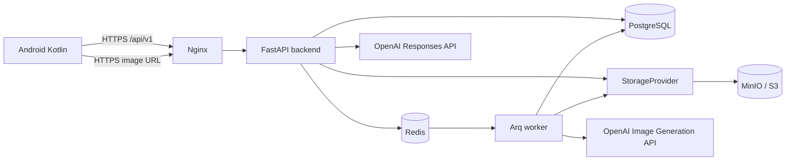
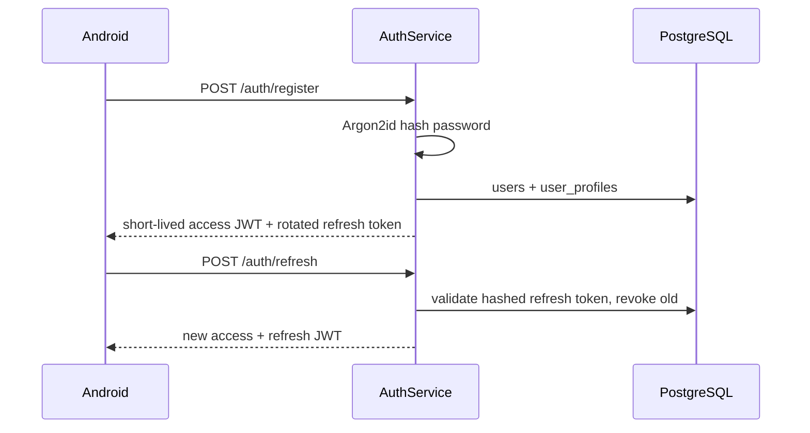
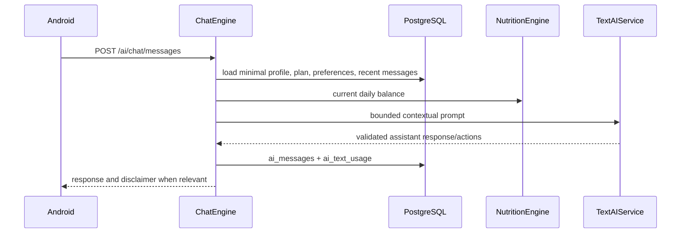

# Архитектура FoodAI

## Итоговое решение

FoodAI — Android-клиент на Kotlin и stateless API на FastAPI. Клиент отображает состояние и отправляет намерения пользователя; персональные расчёты, ограничения, доступ к AI и данные остаются на backend. PostgreSQL хранит предметные данные, Redis обслуживает кэш, rate limits и очередь задач Arq, а MinIO хранит производные изображения блюд. Nginx — единственная внешняя точка входа для API и выдачи файлов.

Выбранный стек:

| Область | Решение | Причина |
|---|---|---|
| Android | Kotlin, Jetpack Compose, MVVM, Hilt, Retrofit/OkHttp, Kotlinx Serialization, Coil, Room для офлайн-кэша только UI-данных | нативная Android-разработка, testable presentation layer и быстрые изображения |
| API | FastAPI, Pydantic v2, SQLAlchemy 2 async, Alembic | типизированный контракт, async I/O, миграции схемы |
| Данные | PostgreSQL | транзакции для планов, целей, лимитов и аудита |
| Кэш и задачи | Redis + Arq | один async-стек Python, отложенные/retry-задачи без тяжёлого второго runtime |
| Файлы | MinIO (S3-compatible) в MVP | локальная совместимость с S3 и переносимость на облачный provider |
| Edge | Nginx | TLS/маршрутизация, request-size limits, безопасная выдача media |
| Текстовый AI | OpenAI Responses API + Structured Outputs | строго валидируемые recipe/plan/chat структуры |
| Изображения | OpenAI Image Generation API через provider | профессиональные фотографии при сохранении файлов у FoodAI |

`OPENAI_API_KEY`, пароли и JWT secrets существуют только в backend/worker environment. Android никогда не вызывает OpenAI, MinIO или Redis напрямую.



## Границы ответственности

| Bounded context / сервис | Владеет | Не владеет |
|---|---|---|
| `AuthService` | регистрация, Argon2id password hashes, access/refresh JWT, logout и rotation refresh token | профиль, тарифы |
| `ProfileService` | анкета, цели, предпочтения и ограничения | расчёт нутриентов без `NutritionEngine` |
| `NutritionEngine` | BMR, TDEE, safe calorie target, deficit, macro targets, пересчёт блюда и дневные проверки | свободный текст AI |
| `RecipeEngine` | schema recipe, canonical ingredients, fingerprint, validation и сохранение рецепта | генерация пикселей |
| `MealPlanEngine` | подбор/проверка набора рецептов, meal slots, replacement и completion | прямой вызов Image API |
| `TextAIService` | Responses API, structured output, AI repair/retry и безопасный chat draft | финальные calories/macros или запись без validation |
| `ImageGenerationService` | prompt, dedup, очередь, provider, оптимизация, metadata/status | создание или блокировка рецепта |
| `ChatEngine` | минимальный contextual prompt, conversation history и действия-предложения | медицинские диагнозы/обещания |
| `ShoppingService` | агрегация `recipe_ingredients`, единицы и marked-complete | изменение рецептур |
| `EntitlementsService` | `require_premium()`, quotas и `PaymentProvider` interface | конкретный billing provider |

Сервисы — отдельные модули с явными интерфейсами, а не один `AIService`. Они могут первоначально работать в одном FastAPI deployment; это не означает микросервисную сеть. Такой модульный monolith сохраняет транзакционность MVP и оставляет границы для выделения позднее.

## Почему backend владеет математикой

AI может предложить блюдо, но не является источником правды о калориях, БЖУ или безопасности. Backend нормализует ингредиенты, сопоставляет их с `ingredients`, умножает значения на граммы и сохраняет только пересчитанный результат. `NutritionEngine`:

1. вычисляет BMR по Mifflin–St Jeor и TDEE по сохранённому activity factor;
2. применяет цель и темп изменения веса, но не допускает суточный target ниже конфигурируемого safety floor;
3. рассчитывает protein/fat/carbohydrate targets;
4. проверяет каждый meal plan по дневной калорийности, БЖУ, аллергиям, exclusions, количеству приёмов пищи, времени, household size и бюджету.

Начальные safety floors конфигурируются как `NUTRITION_MIN_DAILY_CALORIES_FEMALE=1200` и `NUTRITION_MIN_DAILY_CALORIES_MALE=1500`; для неизвестного/иного значения используется более высокий floor до клинического review. Это product guardrail, а не медицинская рекомендация. UI всегда показывает: «Расчёты приблизительны и не заменяют врача или диетолога». Система не ставит диагнозов и не гарантирует снижение веса.

## Основные потоки

### Регистрация и сессия



Access JWT передаётся в `Authorization: Bearer <token>` и живёт недолго. Refresh token хранится в Android EncryptedSharedPreferences/Keystore, а его hash — в `refresh_tokens`; logout отзывает его серверную запись.

### Генерация плана

```mermaid
sequenceDiagram
    participant A as Android
    participant B as FastAPI
    participant N as NutritionEngine
    participant T as TextAIService
    participant R as RecipeEngine
    participant P as PostgreSQL
    participant Q as Redis/Arq
    A->>B: POST /meal-plans/generate
    B->>N: calculate targets and validate constraints
    B->>T: structured plan/recipe proposal
    T-->>B: JSON matching schema
    B->>R: normalize, validate, recalculate nutrients
    R->>P: transaction: plan, recipes, items
    B->>Q: enqueue one image task per deduplicated recipe
    B-->>A: 201 plan; recipes usable, image statuses pending
```

Повторное открытие экрана читает сохранённый план. Оно не вызывает text AI и не создаёт новые image jobs.

### Рецепт и его фото

```mermaid
sequenceDiagram
    participant B as RecipeEngine
    participant P as PostgreSQL
    participant Q as Arq worker
    participant I as Image provider
    participant S as StorageProvider
    participant A as Android
    B->>P: recipe saved (independent of photo)
    B->>Q: enqueue image job
    Q->>P: recipe_images=processing; ai_image_usage=processing
    Q->>I: generate prompt
    I-->>Q: image bytes
    Q->>S: original.webp + thumbnail.webp
    Q->>P: RecipeImage=ready, metadata/URLs
    A->>B: GET /recipes/{id}/image
    B-->>A: status + protected public URL
```

Image API timeout/error помечает только `recipe_images.generation_status=failed`. Сам рецепт остаётся `ready`, открывается без фото и может быть повторно поставлен в очередь с разрешённым retry. Подробнее: [image-generation.md](image-generation.md).

### Контекстный chat



Примеры пользовательских запросов: «Чем заменить курицу на ужин без молочных продуктов?», «Почему сегодня не хватает белка?», «Составь список покупок на завтра». Chat объясняет план, но не выдаёт диагнозы, терапевтические предписания или гарантированный результат.

## Android UX и навигация

Android строится как state-driven client: ViewModel получает API state, UI не пересчитывает nutrition и не знает OpenAI/MinIO credentials. Bottom navigation содержит пять top-level destinations:

| Раздел | Основной экран и действия |
|---|---|
| **Home** | TODAY: текущий weight, goal/progress, daily calories и БЖУ, breakfast/lunch/dinner/snack; переходы в recipe и replace |
| **Plan** | текущий week/day, meal slots, regenerate, completion и recipe detail |
| **Shopping** | aggregated list, filters/checked items, regenerate из plan |
| **Progress** | weight entries, trend, target progress и дневной balance без guaranteed claims |
| **Profile** | editable profile, preferences, restrictions, pantry, goal, tier/usage и logout |

Онбординг — последовательность из семи resumable screens (draft хранится локально до submit):

1. welcome, назначение ассистента и обязательный disclaimer;
2. sex, age, height, current weight;
3. target weight, goal и desired weekly change;
4. activity level и daily calories либо deficit;
5. meals per day, cooking time и household size;
6. weekly grocery budget и продукты дома;
7. liked/disliked foods, excluded foods и allergies с финальным review.

После явного submit показывается «Создаём твой первый план...», Android вызывает `POST /meal-plans/generate` и затем отображает persisted response. Pending photos не задерживают этот экран: recipe cards переходят в `pending/processing/ready/failed` по image contract.

Recipe screen всегда показывает: AI image или status state, name, favorite, calories/БЖУ, cook time, estimated cost, ingredients с граммами, ordered steps, а также actions **Replace**, **Cook**, **Add to shopping**, **Ask AI**. В lists Coil загружает thumbnail, в detail — large image; UI не пытается самостоятельно повторить provider generation.

## Безопасность и границы сети

| Граница | Разрешено | Запрещено/защита |
|---|---|---|
| Android → Nginx | TLS API и URL изображений | секреты, SQL, OpenAI, внутренние service ports |
| Nginx → backend | internal API proxy | доступ к Redis/Postgres из public network |
| backend/worker → OpenAI | ключ из environment, timeout, retry policy | передача password/JWT/API keys, полных профилей без необходимости |
| backend/worker → MinIO | `StorageProvider` credentials | публикация raw internal MinIO URL |
| worker → Redis/Postgres | задача, lock/status и транзакции | выполнение job внутри HTTP request |

Nginx выдаёт media через backend-authorized route или подписанный публичный CDN/domain URL. Bucket остаётся private. Ошибки используют безопасные codes, а structured logs включают request id, user id, endpoint, duration, AI/image duration, status и error class — без password, JWT, API keys и полного профиля.

## Free, Premium и оплаты

`EntitlementsService` проверяет plan до дорогой операции: `require_premium()` для premium-only capability и usage limiter для оконных лимитов. MVP хранит tier и counters в `subscriptions`/`usage_limits`; начальные значения лимитов являются server config, а не Android-константами. Лимиты охватывают AI plan generations, replacements, chat, plan history и image regenerate/generation.

`PaymentProvider` — только интерфейс для будущих `create_purchase`, `verify_purchase`, `cancel`, `get_entitlement`; реальный провайдер в Phase 0 не подключается. Возможные адаптеры: Google Play Billing, RU provider и international provider. Вебхук будущего provider проверяется на backend и меняет entitlement транзакционно.

Связанные решения: [api.md](api.md), [database.md](database.md), [ai.md](ai.md), [storage.md](storage.md), [development.md](development.md), [roadmap.md](roadmap.md).
