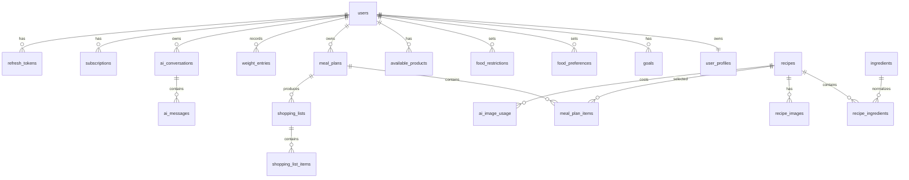

# Модель данных FoodAI

PostgreSQL — authoritative store для product state. Все первичные ключи — `uuid` с server-side `gen_random_uuid()`. Временные поля — `timestamptz` в UTC. Денежные и весовые величины используют `numeric`, никогда `float`; калории — `integer`, БЖУ — `numeric(8,2)`. Каждая изменяемая product-сущность имеет `created_at` и `updated_at`, обновляемый backend/migration trigger.

`varchar` enum-поля валидируются Pydantic и `CHECK` constraints. Email хранится нормализованным lowercase; timezone IANA. `ON DELETE` ниже описывает целевую policy, которая фиксируется Alembic migration.

## Связи

## Identity, profile и ограничения

| Table | Columns | FK / indexes |
|---|---|---|
| `users` | `id uuid PK`; `email varchar(320) NOT NULL`; `password_hash varchar NOT NULL`; `is_active boolean NOT NULL default true`; `locale varchar(16) NOT NULL default 'ru-RU'`; `accepted_terms_at timestamptz`; `email_verified_at timestamptz NULL`; `role varchar(16) NOT NULL default 'user'`; `terms_version varchar(32) NULL`; `privacy_version varchar(32) NULL`; `created_at`; `updated_at` | unique index `lower(email)`; check `role IN ('user','admin')`; never select `password_hash` into API response |
| `user_profiles` | `id uuid PK`; `user_id uuid NOT NULL`; `sex varchar(16)`; `age_years smallint`; `height_cm numeric(5,2)`; `current_weight_kg numeric(6,2)`; `activity_level varchar(32)`; `meals_per_day smallint`; `daily_calorie_mode varchar(16)`; `daily_calorie_value integer`; `grocery_budget_weekly numeric(12,2)`; `currency char(3)`; `max_cook_time_minutes smallint`; `household_size smallint`; `timezone varchar(64)`; `active_goal_id uuid NULL`; `created_at`; `updated_at` | `user_id → users` `CASCADE`, unique `user_id`; `active_goal_id → goals` `SET NULL`; checks positive age/physical values and meals `1..8` |
| `goals` | `id uuid PK`; `user_id uuid NOT NULL`; `goal_type varchar(32)`; `start_weight_kg numeric(6,2)`; `target_weight_kg numeric(6,2)`; `desired_weekly_change_kg numeric(4,2)`; `calorie_target_kcal integer`; `protein_target_g numeric(8,2)`; `fat_target_g numeric(8,2)`; `carbohydrate_target_g numeric(8,2)`; `bmr_kcal integer`; `tdee_kcal integer`; `safety_floor_kcal integer`; `nutrition_policy_version varchar(32) NOT NULL default 'v1'`; `status varchar(16)`; `started_at date`; `ended_at date`; `created_at`; `updated_at` | `user_id → users` `CASCADE`; index `(user_id, status, started_at DESC)`; only one active goal enforced by partial unique index |
| `food_preferences` | `id uuid PK`; `user_id uuid NOT NULL`; `normalized_food_name varchar(255)`; `display_name varchar(255)`; `preference_type varchar(16)` (`liked`/`disliked`); `created_at`; `updated_at` | `user_id → users` `CASCADE`; unique `(user_id, normalized_food_name, preference_type)` |
| `food_restrictions` | `id uuid PK`; `user_id uuid NOT NULL`; `normalized_food_name varchar(255)`; `display_name varchar(255)`; `restriction_type varchar(16)` (`allergy`/`excluded`/`dietary`); `severity varchar(16) NULL`; `created_at`; `updated_at` | `user_id → users` `CASCADE`; unique `(user_id, normalized_food_name, restriction_type)`; no diagnosis field |
| `available_products` | `id uuid PK`; `user_id uuid NOT NULL`; `ingredient_id uuid NULL`; `display_name varchar(255)`; `normalized_name varchar(255)`; `quantity_value numeric(10,2)`; `unit varchar(16)`; `expires_on date NULL`; `created_at`; `updated_at` | `user_id → users` `CASCADE`; `ingredient_id → ingredients` `SET NULL`; index `(user_id, normalized_name)` |
| `weight_entries` | `id uuid PK`; `user_id uuid NOT NULL`; `weight_kg numeric(6,2)`; `measured_at timestamptz`; `note varchar(500) NULL`; `created_at`; `updated_at` | `user_id → users` `CASCADE`; index `(user_id, measured_at DESC)` |
| `nutrition_logs` | `id uuid PK`; `user_id uuid NOT NULL`; `logged_on date`; `meal_type varchar(16)`; `recipe_id uuid NULL`; `meal_plan_item_id uuid NULL`; `description varchar(255)`; `calories_kcal integer`; `protein_g numeric(8,2)`; `fat_g numeric(8,2)`; `carbohydrate_g numeric(8,2)`; `servings numeric(5,2)`; `source varchar(24)` (`meal_plan_item`/`recipe`/`manual`); `created_at`; `updated_at` | `user_id → users` `CASCADE`; `recipe_id → recipes` `SET NULL`; `meal_plan_item_id → meal_plan_items` `SET NULL`; index `(user_id, logged_on)` |
| `email_verification_tokens` / `password_reset_tokens` | `id`; `user_id`; `token_hash char(64)`; `expires_at`; `used_at`; timestamps | `user_id → users` `CASCADE`; unique `token_hash`; plaintext token never stored |
| `product_events` | `id`; `user_id`; `event_name`; `platform`; `app_version`; `properties jsonb`; `occurred_at`; `created_at` | `user_id → users` `CASCADE`; indexes `(event_name, occurred_at)`, `(user_id, occurred_at)` |

Phase 4 добавляет migration `0003_recipe_domain` c `ingredients`, `recipes`, `recipe_ingredients` и `user_recipe_favorites`. Три уточнения к схеме выше, зафиксированные реализацией:

- `ingredients` получает `grams_per_piece numeric(8,2) NULL` и `density_g_per_ml numeric(6,3) NULL`. Без них единицы `piece`, `ml`, `l`, `tbsp` и `tsp` из AI-кандидата невозможно перевести в `quantity_g`, а именно граммы авторитетны для расчёта.
- `recipe_fingerprint` считается от canonicalized `name + cooking_method + servings + отсортированных (ingredient_id, quantity_g)`. `servings` входит в hash, потому что nutrition и cost хранятся на порцию: одинаковый состав, разделённый на разное число порций, — разные рецепты.
- full-text/GIN index по `recipes.name` не создаётся: в MVP нет поиска по названию, индекс появится вместе с первой поисковой функцией. Индекс `(status, updated_at DESC)` создан.

Каталог наполняется seed-набором из 43 распространённых продуктов c `source='seed'`: значения на 100 г и цены приблизительные и заменяются curated-набором без изменения рецептов. `user_recipe_favorites` — единственная таблица без `updated_at`, поэтому у неё нет trigger.

Phase 3 добавляет migration `0002_profile_and_nutrition` c `user_profiles`, `goals`, `food_preferences`, `food_restrictions` и `available_products`: CHECK-и на диапазоны и enum-значения, partial unique index `uq_goals_active_per_user` для единственной active goal, те же `set_updated_at` триггеры и backfill пустого `user_profiles` для уже существующих аккаунтов. `available_products.ingredient_id` создаётся nullable без foreign key — он появится вместе с каталогом `ingredients` в Phase 4. Пересчёт цели обновляет active goal на месте, а `start_weight_kg` остаётся весом на момент создания цели.

Phase 2 создаёт первую migration `0001_auth_and_session` c `users` и `refresh_tokens`: `gen_random_uuid()` primary keys, unique index `lower(email)`, self-referential `replaced_by_id` и trigger-функция `set_updated_at()`, которая поддерживает `updated_at` для каждой таблицы с этой парой полей. Остальные таблицы появляются в своих фазах.

`goals` сохраняет target snapshot: изменения анкеты не переписывают историю завершённых планов. `user_profiles.active_goal_id` должен ссылаться на goal того же user; это проверяется service layer и database trigger/constraint strategy.

## Каталог ингредиентов и рецепты

| Table | Columns | FK / indexes |
|---|---|---|
| `ingredients` | `id uuid PK`; `canonical_name varchar(255)`; `normalized_name varchar(255)`; `default_unit varchar(16)`; `calories_per_100g numeric(8,2)`; `protein_per_100g numeric(8,2)`; `fat_per_100g numeric(8,2)`; `carbohydrate_per_100g numeric(8,2)`; `reference_price_per_100g numeric(12,2) NULL`; `currency char(3) NULL`; `source varchar(32)`; `source_version varchar(32) NULL`; `is_active boolean`; `created_at`; `updated_at` | unique `normalized_name`; checks non-negative nutrition/prices; canonical source for `NutritionEngine`; seed rows use `source_version='seed-v1'` |
| `recipes` | `id uuid PK`; `name varchar(255)`; `description text NULL`; `recipe_fingerprint char(64)`; `cooking_method varchar(64)`; `cook_time_minutes smallint`; `servings smallint`; `calories_kcal integer`; `protein_g numeric(8,2)`; `fat_g numeric(8,2)`; `carbohydrate_g numeric(8,2)`; `estimated_cost_amount numeric(12,2)`; `currency char(3)`; `steps jsonb`; `status varchar(16)`; `ai_model varchar(128) NULL`; `created_at`; `updated_at` | unique `recipe_fingerprint`; indexes `(status, updated_at DESC)` and GIN/full-text `name`; `steps` is ordered safe text, never raw AI object |
| `recipe_ingredients` | `id uuid PK`; `recipe_id uuid NOT NULL`; `ingredient_id uuid NOT NULL`; `display_name varchar(255)`; `quantity_g numeric(10,2)`; `quantity_value numeric(10,2)`; `unit varchar(16)`; `cost_amount numeric(12,2) NULL`; `sort_order smallint`; `created_at`; `updated_at` | `recipe_id → recipes` `CASCADE`; `ingredient_id → ingredients` `RESTRICT`; unique `(recipe_id, sort_order)`; index `(ingredient_id)` |
| `recipe_images` | `id uuid PK`; `recipe_id uuid NOT NULL`; `storage_key varchar(1024) NULL`; `thumbnail_storage_key varchar(1024) NULL`; `width integer NULL`; `height integer NULL`; `format varchar(16) NULL`; `file_size bigint NULL`; `model varchar(128) NULL`; `prompt_hash char(64)`; `generation_status varchar(16)`; `generation_error varchar(512) NULL`; `is_primary boolean NOT NULL default false`; `source_image_id uuid NULL`; `created_at`; `updated_at` | `recipe_id → recipes` `CASCADE`; `source_image_id → recipe_images` `SET NULL`; indexes `(recipe_id, created_at DESC)`, `(generation_status, updated_at)` and partial unique `(recipe_id) WHERE is_primary`; checks ready rows have both keys and dimensions |
| `user_recipe_favorites` | `user_id uuid`; `recipe_id uuid`; `created_at` | composite PK `(user_id, recipe_id)`; FKs to `users`/`recipes` `CASCADE`; index `(user_id, created_at DESC)` |

`recipe_fingerprint` — SHA-256 от canonicalized `name + ingredients (canonical id/name) + quantities_g + cooking_method`; сортировка ингредиентов и нормализация регистра/единиц обязательны. Он создаётся только после backend validation. Уникальный fingerprint позволяет повторно использовать canonical recipe и его готовое primary image между пользователями, не храня профиль пользователя в рецепте. Доступ к рецепту всё равно проверяется через `meal_plan_items` или favorite текущего user.

`is_primary` обеспечивает 1→N `RecipeImage` с одним primary image. Перед новым regenerate worker сначала берёт recipe-level lock и проверяет ready primary с тем же fingerprint/prompt style; duplicate job не создаётся. `source_image_id` документирует безопасное переиспользование, если оно необходимо.

## План, список покупок

| Table | Columns | FK / indexes |
|---|---|---|
| `meal_plans` | `id uuid PK`; `user_id uuid NOT NULL`; `goal_id uuid NOT NULL`; `start_date date`; `end_date date`; `status varchar(16)`; `calorie_target_kcal integer`; `protein_target_g numeric(8,2)`; `fat_target_g numeric(8,2)`; `carbohydrate_target_g numeric(8,2)`; `nutrition_policy_version varchar(32) NOT NULL default 'v1'`; `generation_request_hash char(64) NULL`; `created_at`; `updated_at` | `user_id → users` `CASCADE`; `goal_id → goals` `RESTRICT`; indexes `(user_id, start_date DESC)`, `(user_id, status, start_date)` and unique `(user_id, generation_request_hash)` where non-null |
| `meal_plan_items` | `id uuid PK`; `meal_plan_id uuid NOT NULL`; `recipe_id uuid NOT NULL`; `planned_date date`; `meal_type varchar(16)`; `servings numeric(5,2)`; `sort_order smallint`; `status varchar(16)`; `is_completed boolean`; `completed_at timestamptz NULL`; `calories_kcal integer`; `protein_g numeric(8,2)`; `fat_g numeric(8,2)`; `carbohydrate_g numeric(8,2)`; `estimated_cost_amount numeric(12,2)`; `created_at`; `updated_at` | `meal_plan_id → meal_plans` `CASCADE`; `recipe_id → recipes` `RESTRICT`; unique `(meal_plan_id, planned_date, meal_type, sort_order)`; indexes `(meal_plan_id, planned_date)`, `(recipe_id)` |
| `shopping_lists` | `id uuid PK`; `user_id uuid NOT NULL`; `meal_plan_id uuid NOT NULL`; `from_date date`; `to_date date`; `status varchar(16)`; `generated_at timestamptz`; `created_at`; `updated_at` | `user_id → users` `CASCADE`; `meal_plan_id → meal_plans` `CASCADE`; index `(user_id, updated_at DESC)` |
| `shopping_list_items` | `id uuid PK`; `shopping_list_id uuid NOT NULL`; `ingredient_id uuid NULL`; `normalized_name varchar(255)`; `display_name varchar(255)`; `quantity_value numeric(10,2)`; `unit varchar(16)`; `is_completed boolean`; `completed_at timestamptz NULL`; `source_recipe_count integer`; `created_at`; `updated_at` | `shopping_list_id → shopping_lists` `CASCADE`; `ingredient_id → ingredients` `SET NULL`; unique `(shopping_list_id, normalized_name, unit)` |

Nutrition fields в `meal_plan_items` — immutable snapshot именно выбранного рецепта/порции на дату. Это делает historical plan воспроизводимым, даже если обновится справочник ingredient prices.

## AI, usage и entitlement

| Table | Columns | FK / indexes |
|---|---|---|
| `ai_conversations` | `id uuid PK`; `user_id uuid NOT NULL`; `title varchar(255) NULL`; `context_plan_id uuid NULL`; `status varchar(16)`; `created_at`; `updated_at` | `user_id → users` `CASCADE`; `context_plan_id → meal_plans` `SET NULL`; index `(user_id, updated_at DESC)` |
| `ai_messages` | `id uuid PK`; `conversation_id uuid NOT NULL`; `role varchar(16)`; `content text`; `suggested_actions jsonb NULL`; `model varchar(128) NULL`; `input_tokens integer NULL`; `output_tokens integer NULL`; `created_at`; `updated_at` | `conversation_id → ai_conversations` `CASCADE`; index `(conversation_id, created_at)`; `role` is `user`/`assistant`/`system` |
| `ai_image_usage` | `id uuid PK`; `user_id uuid NULL`; `recipe_id uuid NOT NULL`; `recipe_image_id uuid NULL`; `model varchar(128)`; `size varchar(32) NULL`; `quality varchar(32) NULL`; `status varchar(16)`; `estimated_cost numeric(12,6) NULL`; `duration_ms integer NULL`; `error_code varchar(128) NULL`; `retry_count smallint NOT NULL default 0`; `created_at`; `updated_at` | `user_id → users` `SET NULL`; `recipe_id → recipes` `CASCADE`; `recipe_image_id → recipe_images` `SET NULL`; indexes `(user_id, created_at DESC)`, `(model, status, created_at DESC)`, `(recipe_id, created_at DESC)` |
| `ai_text_usage` | `id uuid PK`; `user_id uuid NOT NULL`; `conversation_id uuid NULL`; `operation varchar(32)`; `model varchar(128)`; `input_tokens integer NULL`; `output_tokens integer NULL`; `estimated_cost numeric(12,6) NULL`; `status varchar(16)`; `duration_ms integer NULL`; `error_code varchar(128) NULL`; `created_at`; `updated_at` | `user_id → users` `CASCADE`; `conversation_id → ai_conversations` `SET NULL`; indexes `(user_id, created_at DESC)`, `(operation, model, created_at DESC)` |
| `subscriptions` | `id uuid PK`; `user_id uuid NOT NULL`; `tier varchar(16)`; `status varchar(16)`; `provider varchar(32) NULL`; `provider_subscription_id varchar(255) NULL`; `current_period_start timestamptz`; `current_period_end timestamptz NULL`; `created_at`; `updated_at` | `user_id → users` `CASCADE`; unique `(provider, provider_subscription_id)` where provider id non-null; index `(user_id, status)`; Phase 0 uses no real provider |
| `usage_limits` | `id uuid PK`; `user_id uuid NOT NULL`; `feature varchar(64)`; `window_start timestamptz`; `window_end timestamptz`; `limit_value integer`; `used_value integer`; `created_at`; `updated_at` | `user_id → users` `CASCADE`; unique `(user_id, feature, window_start)`; index `(user_id, feature, window_end)` |
| `refresh_tokens` | `id uuid PK`; `user_id uuid NOT NULL`; `token_hash char(64)`; `family_id uuid`; `expires_at timestamptz`; `revoked_at timestamptz NULL`; `replaced_by_id uuid NULL`; `last_used_at timestamptz NULL`; `device_label varchar(128) NULL`; `platform varchar(32) NULL`; `app_version varchar(32) NULL`; `created_at`; `updated_at` | `user_id → users` `CASCADE`; `replaced_by_id → refresh_tokens` `SET NULL`; unique `token_hash`; indexes `(user_id, expires_at)`, `(family_id)` |
| `idempotency_keys` | `id uuid PK`; `user_id uuid NOT NULL`; `key varchar(255)`; `endpoint varchar(128)`; `request_hash char(64)`; `response_status smallint NULL`; `response_body jsonb NULL`; `expires_at timestamptz`; `created_at`; `updated_at` | `user_id → users` `CASCADE`; unique `(user_id, endpoint, key)`; automatic expiry cleanup |

`ai_image_usage` — source будущего admin отчёта: count/errors/estimated cost по user/model, длительность и retries. `usage_limits` изменяется транзакционно или через atomic SQL increment до запуска provider call. Cache hits/deduplicated image reuse записываются с `status='reused'` и нулевой estimated cost, чтобы отчёты не завышали затраты.

## Что не хранится в PostgreSQL

Image bytes не записываются в таблицы: они ухудшают backup/restore, раздувают WAL, не дают object-storage lifecycle/CDN и мешают независимому image processing. PostgreSQL хранит только `storage_key`, `thumbnail_storage_key`, dimensions, format, file size, provider model, prompt hash и status. Файлы лежат за `StorageProvider`; путь и access policy описаны в [storage.md](storage.md).

Секреты, plaintext passwords, JWT, OpenAI responses без validation, raw prompt с полным личным профилем и внутренние storage URLs также не сохраняются. Политика retention и backup: [development.md](development.md). API contract: [api.md](api.md).
