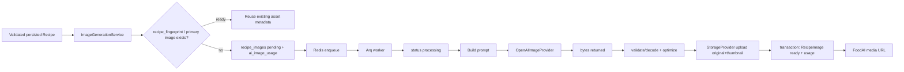

# Генерация изображений блюд

Каждое photo — отдельный производный asset, связанный с `recipe_id`. Рецепт сначала становится валидным и usable; генерация фото никогда не создаёт, не переписывает и не блокирует рецепт. Если Image API недоступен, `RecipeImage` становится `failed`, а dish card продолжает показывать calories, БЖУ, ингредиенты и шаги.

## Модули и интеграционная граница

Phase 1+ следует этому layout; в Phase 0 файлы не создаются:

```text
backend/app/
├── images/
│   ├── client.py       # typed image-provider boundary used by image domain
│   ├── generator.py    # Arq worker callable: generate, optimize, upload, persist status
│   ├── prompts.py      # pure deterministic prompt builder + prompt hash input
│   ├── storage.py      # image asset operations over StorageProvider
│   ├── schemas.py      # ImageRequest/ImageResult/status/provider contracts
│   └── service.py      # enqueue, dedup, read, regenerate/retry authorization
└── integrations/
    └── openai/
        ├── client.py   # the only OpenAI SDK initialization/configuration
        ├── text.py     # OpenAIResponsesProvider
        └── images.py   # OpenAIImageProvider
```

Это один OpenAI integration layer: application services не импортируют OpenAI SDK. `images/client.py` определяет protocol `ImageGenerationProvider`; production adapter — `OpenAIImageProvider`, test adapter — `MockImageProvider`. `StorageProvider` предоставляет `upload`, `download`, `delete`, `get_public_url`, `get_presigned_url`. Бизнес-логика зависит от этих interfaces, поэтому MinIO можно сменить на S3/Yandex/R2 без изменений recipe/image logic.

## Полный pipeline



### По шагам

1. `RecipeEngine` сохраняет только валидированный рецепт с stable `recipe_fingerprint`.
2. `ImageGenerationService.enqueue_for_recipe()` берёт recipe-level lock, проверяет `RecipeImage` со `status in (pending, processing)` и primary `ready`.
3. Если найден canonical recipe/image с совпадающим fingerprint и style/prompt policy, asset переиспользуется: новая provider generation не запускается и usage отмечается `reused`.
4. Иначе backend создаёт `recipe_images` со `generation_status='pending'`, `is_primary` согласно transaction, и `ai_image_usage` со `status='pending'`; затем ставит Arq job в Redis.
5. HTTP `POST /meal-plans/generate` возвращается сразу после database transaction/enqueue. Он не ожидает image provider.
6. Worker atomically переводит job в `processing`, строит prompt из persisted recipe и обращается к provider с timeout.
7. Worker принимает только expected image bytes/base64 from provider, ограничивает MIME/размер/dimensions, удаляет unnecessary metadata, конвертирует/оптимизирует и загружает два object keys.
8. После обоих upload одна транзакция обновляет image metadata и `ai_image_usage` до `ready`. URL вычисляется на выдаче, не хранится как raw MinIO URL.
9. При transient failure worker делает bounded retry с backoff; после maximum attempts записывает `failed` и безопасный `generation_error`/usage error code. Recipe остаётся ready.

Если upload original прошёл, а thumbnail нет, worker удаляет original best-effort и не выставляет `ready`; ready означает наличие обеих variants. Crash recovery находит зависшие `processing` jobs по timeout и переводит их в retry/failed согласно policy.

## Prompt

`prompts.py` строит prompt только из validated recipe: canonical name, finished dish, ingredients/amounts, cooking method, plating intent и servings. Пример template:

```text
Modern professional food photography of the finished dish: "{recipe_name}".
Show the actual finished meal with these key ingredients: {key_ingredients}.
{cooking_method}, plated as a realistic home meal for {servings} serving(s).
Appetizing but truthful portion, clean thoughtful plating and suitable neutral dishware.
Natural soft light, neutral uncluttered background, clean composition, high detail,
realistic food texture, editorial food photography.
No text, labels, logos, people, hands, brand packaging, watermarks, cartoon style,
or unrelated ingredients.
```

Unified default style: **modern professional food photography — realistic, appetizing, natural lighting, clean composition, high detail, realistic texture**. Cartoon/illustration возможны только по будущему явному user preference; они не являются default и не меняют nutrition/recipe. Не добавлять несовместимые с recipe garnishes, raw аллергенные ingredients, бренды или текст. Prompt не включает user email, weight, allergy history или секреты.

`prompt_hash = SHA-256(template_version + normalized recipe_fingerprint + style + relevant model configuration)`. Его задача — audit/dedup, не хранение полного prompt в database.

## Форматы, keys и доставка

Provider может вернуть PNG. Worker декодирует его и сохраняет mobile variants как `WEBP` (default) или configured `JPEG`; исходные provider bytes не являются permanent store.

| Variant | Object key | Цель |
|---|---|---|
| original | `images/recipes/{recipe_id}/original.webp` | full recipe screen, ограниченный long edge/quality policy |
| thumbnail | `images/recipes/{recipe_id}/thumbnail.webp` | Plan/Home lists, smaller dimensions and file size |

Фактическое extension соответствует `OPENAI_IMAGE_FORMAT`/post-processing output. `recipe_images` хранит `storage_key`, `thumbnail_storage_key`, `width`, `height`, `format`, `file_size`, `model`, `prompt_hash`, `generation_status`, `generation_error`, `is_primary`, timestamps — не bytes.

MinIO bucket private. API выдаёт только FoodAI-controlled URL, например `https://api.foodai.example/media/recipes/.../thumbnail.webp`, через Nginx/backend authorization или signed CDN URL. Никогда не возвращать internal `http://minio:9000/...`, bucket hostname, access key или secret key.

Android использует Coil: thumbnail в Home/Plan, original в recipe screen, memory+disk cache по stable FoodAI URL. UI отображает:

| status | Поведение |
|---|---|
| `pending` | placeholder/shimmer |
| `processing` | placeholder + «Готовим фото блюда...» |
| `ready` | `thumbnail_url`/`url` в Coil |
| `failed` | «Изображение пока недоступно.»; retry control только при `retry_allowed=true` |

Контракт endpoint: `GET /api/v1/recipes/{id}/image` и `GET /api/v1/recipes/{id}/images`; подробный JSON — [api.md](api.md).

## Status, concurrency и regenerate

Допустимые lifecycle состояния — `pending → processing → ready` либо `pending/processing → failed`. Только worker меняет `processing/ready/failed`; service создаёт pending/retry. `recipe_images` — 1→N history, но partial unique index гарантирует один `is_primary=true` на recipe.

`POST /api/v1/recipes/{id}/image/regenerate` создаёт новый pending row/asset только после authorization, `require_premium()` при нужном tier и rate limit. Стартовая policy: максимум два accepted regenerate requests на recipe за 24 часа, плюс configurable global/user concurrency. `POST /api/v1/images/{id}/retry` работает только для `failed`, соблюдает `IMAGE_MAX_RETRIES`, не раскрывает provider error. При уже pending/processing generation server отвечает `409`; concurrent duplicate providers не запускаются.

Новый `ready` image переводит старый primary в non-primary в одной transaction. Старые versions можно хранить для audit и удалить lifecycle job согласно retention; удаление storage objects выполняется через `StorageProvider`, а не SQL blob cleanup.

## Dedup и контроль цены

`recipe_fingerprint` — hash normalized name + canonical ingredients + grams + cooking method. До любой генерации сервис ищет existing canonical recipe с fingerprint и usable primary image. Совпадение означает reuse, а не новое image per user. При регенерации сравниваются также style/template version: намеренная смена visual policy может создать новую version, но не без rate limit.

`ai_image_usage` записывает на каждую попытку/переиспользование:

```text
id, user_id, recipe_id, recipe_image_id, model, size, quality, status,
estimated_cost, duration_ms, error_code, retry_count, created_at, updated_at
```

Будущий admin view агрегирует counts, errors и estimated cost по user/model/status. Redis rate limits, persisted recipe/image results, idempotency и fingerprint dedup предотвращают расходы при повторном открытии экрана или Android retry.

## Config-driven Image Generation API

```dotenv
OPENAI_API_KEY=
OPENAI_IMAGE_MODEL=gpt-image-2
OPENAI_IMAGE_SIZE=
OPENAI_IMAGE_QUALITY=
OPENAI_IMAGE_FORMAT=webp
OPENAI_IMAGE_TIMEOUT_SECONDS=60
IMAGE_MAX_RETRIES=3
IMAGE_MAX_CONCURRENT_JOBS=
IMAGE_ORIGINAL_MAX_EDGE=
IMAGE_THUMBNAIL_MAX_EDGE=
IMAGE_WEBP_QUALITY=
```

`OPENAI_IMAGE_MODEL` default ориентирован на `gpt-image-2`/GPT-Image-2, но не hardcoded: model swap — config-only. `OpenAIImageProvider` хранит versioned capability map выбранной model и передаёт в Image Generation API только параметры, поддерживаемые этой model. Пустые/unsupported `size`, `quality` или `format` не отправляются; worker применяет local conversion when API returns PNG. Неподдерживаемая required configuration должна fail fast на startup/config validation, а не отправлять неизвестный параметр provider.

Не использовать OpenAI как permanent image store: результат скачивается/декодируется немедленно, сохраняется через `StorageProvider`, а provider URL/temporary asset не отдаётся Android.

## Tests

pytest обязан покрывать `MockImageProvider`: happy path, provider timeout, malformed bytes, optimize/upload failure, status transitions, orphan cleanup, no duplicate jobs, fingerprint reuse, retry maximum, primary-image uniqueness, ownership, Premium/rate limits и safe image URL. Unit/integration tests не вызывают реальный OpenAI Image Generation API и не требуют real account/key.

Хранилище и backup: [storage.md](storage.md). Общая архитектура: [architecture.md](architecture.md). Таблицы: [database.md](database.md). Development policy: [development.md](development.md).
