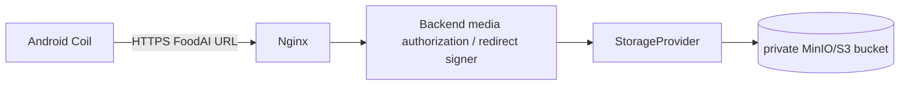

# Хранилище изображений FoodAI

FoodAI хранит generated images в object storage, не в PostgreSQL и не у OpenAI. В MVP используется private MinIO, совместимый с S3 API; production adapter выбирается конфигурацией без изменения recipe/image business logic.

## `StorageProvider`

Все image code использует один async interface:

| Method | Контракт |
|---|---|
| `upload(key, data, content_type, cache_control)` | атомарно сохраняет bytes по key, возвращает metadata без public credentials |
| `download(key)` | возвращает bytes для optimize/recovery; не exposed Android |
| `delete(key)` | idempotent best-effort удаление объекта |
| `get_public_url(key)` | возвращает только FoodAI delivery URL, не raw object endpoint |
| `get_presigned_url(key, expires_in)` | создаёт scoped short-lived URL только для разрешённого server flow |

Initial adapters: `MinIOStorageProvider` для local Docker Compose и `MockStorageProvider` для tests. Следующие production adapters реализуют тот же interface: AWS S3, Yandex Object Storage, Cloudflare R2. Domain code не знает bucket/client SDK/endpoint provider.

## Objects и metadata

Для готового primary recipe image обязательны два keys:

```text
images/recipes/{recipe_id}/original.webp
images/recipes/{recipe_id}/thumbnail.webp
```

При future non-primary regeneration key включает immutable image id, например `images/recipes/{recipe_id}/{image_id}/original.webp`; это предотвращает перезапись history. Extension отражает фактический optimized format (`webp` default или `jpeg`), а не временный provider response. Worker сохраняет `Cache-Control` policy для mobile caching и appropriate `Content-Type`.

В `recipe_images` остаются только keys и metadata: dimensions, format, file size, model, prompt hash, `generation_status`, bounded error, `is_primary` и timestamps. PostgreSQL blob storage запрещён: он раздувает WAL/backups, затрудняет lifecycle/CDN и соединяет database availability с media delivery.

## MinIO в MVP

Документируемый Compose service: `minio`, с named persistent volume `minio_data`, отдельным internal network и healthcheck к readiness endpoint. Backend/worker получают:

```dotenv
S3_PROVIDER=minio
S3_ENDPOINT=http://minio:9000
S3_REGION=us-east-1
S3_BUCKET=foodai-images
S3_ACCESS_KEY=
S3_SECRET_KEY=
S3_USE_SSL=false
MEDIA_PUBLIC_BASE_URL=https://api.foodai.example/media
S3_PRESIGNED_URL_TTL_SECONDS=300
MINIO_ROOT_USER=
MINIO_ROOT_PASSWORD=
```

`MINIO_ROOT_USER`/`MINIO_ROOT_PASSWORD` нужны только MinIO bootstrap/provisioning и не передаются приложению. Provisioning создаёт private bucket и отдельную least-privilege пару `S3_ACCESS_KEY`/`S3_SECRET_KEY` для backend/worker. Все эти значения существуют только в `.env`/secret manager; public bucket и anonymous list/read запрещены. Local MinIO console не публикуется production edge. Named `minio_data` volume сохраняет объекты между контейнерными перезапусками.

Documented Compose topology включает `postgres`, `redis`, `backend`, `worker`, `nginx`, `minio`; у каждого service есть healthcheck. `backend`/`worker` не считаются ready до доступности нужной зависимости; Nginx проверяет backend `/health`, а image generation не является healthcheck dependency.

## Delivery и access control



Есть два разрешённых production варианта:

1. Nginx/backend авторизует recipe access и stream/proxy объекта.
2. Backend проверяет ownership, затем возвращает short-lived signed URL на custom public CDN domain.

Выбор фиксируется deployment config, но Android всегда видит `MEDIA_PUBLIC_BASE_URL`/FoodAI domain, а не `http://minio:9000`, `s3://...` или provider credentials. URL в image API nullable, пока status не `ready`. Coil получает `thumbnail_url` для списков и `url` для recipe screen, используя standard memory/disk cache.

Нельзя выдавать generic presigned URL без authorization check. API проверяет, что текущий user имеет recipe через свой `meal_plan_item`/favorite. Cache headers не должны позволять shared proxy раскрыть protected private asset другому user; если URL bearer-like, он короткоживущий и `Cache-Control: private`.

## Image worker integration

Arq worker получает только `recipe_id`/`recipe_image_id`, читает recipe и пишет bytes через `StorageProvider`. Он не принимает bytes от Android. До `ready` worker:

1. получает image bytes от provider;
2. validates mime/size and decodes image;
3. strips excess metadata and converts PNG when needed;
4. creates mobile-optimized original and thumbnail;
5. uploads both variants;
6. transactionally writes their keys/metadata/status.

Failure upload/optimization не меняет recipe и не публикует broken URL. Если cleanup нужен, worker использует `delete`. Полный status/retry/dedup policy: [image-generation.md](image-generation.md).

## Backup, retention и restore

| Asset | Backup policy | Restore check |
|---|---|---|
| PostgreSQL | encrypted logical dump/PITR per production policy; backup credential separate from app | restore в isolated database, run schema/integrity check |
| MinIO bucket | versioned object replication/snapshot to distinct storage account/region | sample restore original+thumbnail and match `recipe_images.storage_key` |
| `.env` / provider credentials | не в database dump и не в git; secret manager version/rotation procedure | inject into isolated environment, never copy values to logs |

Backup job captures database and object-storage consistency marker: `recipe_images` rows may be temporarily `pending`/`processing`, but `ready` must reference objects present in backup. Restore run schedules repair/retry only for missing non-ready/failed assets; it never silently marks a recipe unavailable. Retention deletes expired non-primary assets only after storage delete and DB audit record; primary ready assets obey product retention policy.

## Security rules

- TLS только между Android и public Nginx/CDN; internal Docker network не является public.
- Storage credentials are least-privilege bucket scoped, rotated and redacted from logs.
- Validate object key prefix server-side; no user-supplied arbitrary key/path traversal.
- Apply maximum source/processed bytes, dimensions, MIME allowlist and decode limits before storage.
- Log request/image id, status, duration and error class; never binary contents, raw signed URL credentials, API keys or full profile.
- Tests используют `MockStorageProvider`; integration tests могут запускать local MinIO, но никогда production bucket.

Детали database metadata: [database.md](database.md). Environment и local workflow: [development.md](development.md). API response contract: [api.md](api.md).
